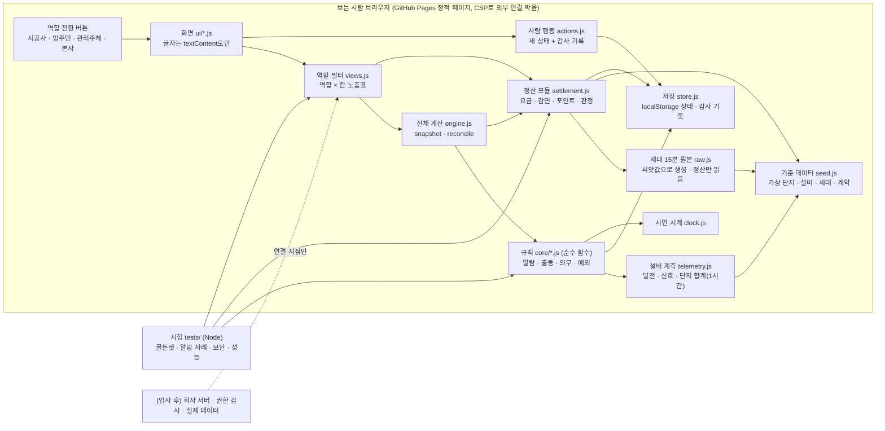

# 아키텍처

> 상태: 승인 · 구현에 맞춰 고침(2026-11-24) · 근거: [requirements.md](requirements.md)

## 1. 구성도

- 서버가 없다. 페이지 · 스크립트 · 기준 데이터만 올린다. 외부 요청 0건(AC-48).
- 화면은 규칙 · 정산을 직접 부르지 않고 **역할 필터(views.js)**를 거친다. 필터가 역할 × 칸 노출표대로 걸러서 넘긴다(AC-02).
- 15분 원본은 정산 모듈만 읽는다. 화면 쪽에는 1시간 합계만 나온다(AC-46).
- 같은 규칙 · 정산 코드를 브라우저와 시험이 함께 쓴다. 그래서 시험 결과가 화면 동작과 같다.

## 2. 구성 요소 역할

| 파일(예정) | 역할 | 관련 AC |
|---|---|---|
| `site/index.html` | 화면 틀, CSP 메타 태그, 시연 안내 1줄 | AC-05 · AC-48 |
| `site/js/app.js` | 시작 · 역할 전환 · 화면 다시 그리기 | AC-01 · AC-55 |
| `site/js/views.js` | 역할 × 칸 노출표, 역할별 화면 데이터 만들기(걸러 낸 뒤 넘김) | AC-02~04 · AC-36 · AC-43 · AC-45 · AC-46 |
| `site/js/core/alarms.js` | 알람 감지 규칙(통신 끊김 · 발전 저하 · 안전 · 설비 종류별 기준), 재발 묶기, 올림, 종결 조건 | AC-06~18 · AC-60~66 |
| `site/js/core/dispatch.js` | 출동 묶음 제안(같은 구역 · 손실 큰 순 최대 5곳) | AC-19 |
| `site/js/core/obligations.js` | 의무 3가지 기한 · 남은 날 · 기한 임박 · 보증 청구 대상 · 보고서 초안 | AC-21~24 |
| `site/js/core/exceptions.js` | 예외 5종 + 이관 결정(본사 임시 관리 30일) 분류, 마감 잠금 조건 | AC-31 · AC-32 · AC-67 |
| `site/js/core/settlement.js` | **유일한 계산 모듈**: 구독 요금 · 일할 · 감면 · 상한 · 미션 판정 · 포인트 · 예산 · 교차 검사 · 마감 | AC-25~30 · AC-33 · AC-37~41 · AC-44 · AC-59 |
| `site/js/core/raw.js` | **세대** 15분 원본 생성(씨앗값, 같은 입력이면 같은 값) · 삭제된 달이면 오류. 정산 모듈만 불러 씀 | AC-46 · AC-47 |
| `site/js/core/telemetry.js` | **설비** 계측(1시간: 발전 · 데이터 수신 · 살아 있음 신호 · 안전 신호), 회사 쪽 수집 중단, 단지 발전 · 공용 사용 합계, 미션 시간 | AC-06~11 · AC-37 |
| `site/js/core/engine.js` | 전체 계산(snapshot)과 반영(reconcile: 미션 판정 기록 · 담당 변경 · 원본 삭제 감사 기록) | AC-16 · AC-47 |
| `site/js/core/actions.js` | 사람 행동(출동 확정 · 조치 입력 · 보고서 제출 · 예외 판정 · 예산 승인 · 이의 · 재심 · 마감). 새 상태를 돌려주고 감사 기록을 덧붙임 | AC-19 · AC-23 · AC-34 · AC-40 · AC-44 |
| `site/js/core/audit.js` | 감사 기록 덧붙이기만(고치기 · 지우기 없음), 개인정보 원문 0 | AC-34 · AC-35 |
| `site/js/core/store.js` | localStorage 읽기 · 쓰기, 형식 버전, 깨지면 기본값 복구, 초기화 | AC-52 · AC-53 |
| `site/js/core/clock.js` | 시연 시각(고정 시작 + '1시간 · 1일 앞으로'), 규칙에 시각을 주입 | AC-07 · AC-13 · AC-15 · AC-47 |
| `site/js/data/seed.js` | 가상 단지 · 설비 · 세대(가명 ID) · 시공사 · 계약 · 요금제 · 제휴 예산 | AC-51 |
| `site/js/ui/*.js` | 역할별 화면(시공사 · 입주민 · 관리주체 · 본사) · 지도(SVG 배치도) | AC-20 · AC-42 |
| `tests/*.test.mjs` | 요구 1개 ↔ 시험 1개(`test_acNN_`), 정산 골든셋(`tests/golden/settlement.json`), 알람 사례 10가지, 레드팀 · 정상 대조군, innerHTML 0곳 검사 | AC-49 · AC-50 · AC-56 |
| `tools/run-tests.mjs` | 시험을 모두 돌려 `tmp/test-results.json` 1개를 남김. 건너뛴 시험은 통과로 세지 않음 | AC-56 |
| `tools/secret_scan.mjs` | 저장소 안 비밀값 검사(배포 작업에서 실행). 값은 출력하지 않고 파일:줄만 | AC-54 |
| `.github/workflows/pages.yml` | 검사 · 시험 · 올리기 작업 → `needs:`로 이은 **별도** 배포 작업 | AC-54 |

## 3. 호출 흐름 (예: 시공사가 화면을 열 때)

1. `app.js`가 시연 시각(`clock`)과 저장 상태(`store`)를 읽는다.
2. `views.forRole('contractor', 담당 시공사 ID)`를 부른다.
3. `engine.snapshot`이 `alarms.evaluate`로 열린 알람을 계산한다. 알람은 저장하지 않고, 설비 계측(1시간)과 사람 행동 기록으로 매번 다시 계산한다(ADR 0006). 세대 15분 원본은 정산 전용이다.
   사람이 지금 누른 행동(출동 확정 · 조치 입력)은 같은 시각에 바로 반영한다.
4. `views`가 노출표대로 칸을 걸러(세대 ID · 사용량 제거) 화면 데이터로 돌려준다.
5. `ui/contractor.js`가 `textContent`로 그린다. 지도는 SVG 요소를 `createElementNS`로 만든다.

알람 감지에 필요한 발전 · 신호 값은 '설비 계측'이고, 세대 사용량은 '세대 계측'이다. 15분 단위 제한(AC-46)은 **세대 사용량 원본**에 건다. 설비 계측은 세대 개인정보가 아니라 알람 규칙이 1시간 단위로 읽는다.

## 4. 보안 설계

### 4-1. 신뢰 경계 × STRIDE

STRIDE = 위장(S) · 변조(T) · 부인(R) · 정보 노출(I) · 서비스 거부(D) · 권한 상승(E).

| 경계 | S | T | R | I | D | E |
|---|---|---|---|---|---|---|
| 역할 전환 버튼 ↔ 화면 데이터 | 누구나 역할을 고를 수 있음 → 시연 한계로 표시(SEC-01) | — | 행동마다 역할을 감사 기록(SEC-07) | 노출표 필터(SEC-02) · 세대 값 제거(SEC-03) | — | 화면이 규칙을 직접 못 부름, 필터 경유(SEC-02) |
| 브라우저 저장소 ↔ 앱 | — | 사용자가 저장 값을 고칠 수 있음 → 버전 · 형식 검사, 깨지면 복구(SEC-06) | 감사 기록 덧붙이기만(SEC-07) | 가상 데이터만 · 가명 ID(SEC-05) | 저장 실패해도 기본값으로 동작(SEC-06) | 저장 값의 역할 칸은 믿지 않고 매번 버튼 상태로 정함(SEC-01) |
| 사용자 입력 칸 ↔ 화면 | — | 스크립트 · HTML 조각 → 글자로만(SEC-04) | — | — | 긴 입력 → 글자 수 제한 500자(SEC-04) | 입력이 규칙 값(금액 · 기한)을 못 바꿈(SEC-04) |
| 정산 모듈 ↔ 15분 원본 | — | 원본은 생성 전용, 저장하지 않음(SEC-08) | 원본 삭제를 감사 기록(SEC-07) | 정산만 읽음 · 화면엔 1시간 합계(SEC-08) | 마감 3초 안 계산(SEC-08) | 다른 모듈의 원본 불러오기 0곳을 시험(SEC-08) |
| 페이지 ↔ 외부 인터넷 | — | — | — | CSP `connect-src 'none'` · 외부 글꼴 · 지도 · 분석 도구 0(SEC-09) | — | — |
| 저장소 · 배포 ↔ 공개 | — | — | 배포는 작업 기록에 남음 | 비밀값 검사 0건일 때만 배포(SEC-10) · 회사 이름 0(SEC-11) | — | — |

### 4-2. 통제 목록

| ID | 통제 | 강제 수단 | 위치 | 충족 요구 |
|---|---|---|---|---|
| SEC-01 | 역할 나누기는 시연이라고 밝힘, 역할은 버튼 상태로만 정함 | 화면 안내 1줄 · 저장 값 무시 | `index.html` · `app.js` | AC-05 |
| SEC-02 | 역할 × 칸 노출표 필터 | 노출표 시험(역할 4개 × 금지 칸) | `views.js` | AC-02 |
| SEC-03 | 세대 값 최소 노출 | 시험: 시공사 · 관리주체 · 본사 화면 데이터에 세대 값 0 | `views.js` | AC-03 · AC-04 · AC-45 |
| SEC-04 | 입력은 글자로만, 500자 제한, 규칙 값 변경 불가 | 시험: innerHTML 0곳 · 레드팀 입력 실행 0 · 정상 대조군 | `ui/*.js` · 시험 | AC-49 · AC-50 |
| SEC-05 | 가상 데이터 · 가명 ID · 실제 형식 연락처 0 | 데이터 점검 시험(전화 · 메일 · 주소 모양 검색) | `seed.js` | AC-51 |
| SEC-06 | 저장 형식 버전 · 깨지면 복구 · 초기화 | 시험: 깨진 값 넣기 | `store.js` | AC-52 · AC-53 |
| SEC-07 | 감사 기록 덧붙이기만, 개인정보 원문 0 | 시험: 수정 · 삭제 함수 없음 · 기록 내용 검사 | `audit.js` | AC-34 · AC-35 |
| SEC-08 | 15분 원본은 정산만 · 저장 안 함 · 삭제 표시 | 시험: raw.js를 불러 쓰는 파일이 settlement.js뿐인지 · 화면 데이터 15분 값 0 | `raw.js` · `settlement.js` | AC-46 · AC-47 |
| SEC-09 | 외부 연결 0 | CSP 메타 태그 · 시험: 소스에 http(s) 외부 주소 불러오기 0(출처 링크 `<a>`는 예외) | `index.html` | AC-48 |
| SEC-10 | 비밀값 0일 때만 배포 | 배포 작업 앞 검사 단계 · 커밋 전 검사 | `tools/secret_scan.mjs` · 작업 파일 | AC-54 |
| SEC-11 | 회사 · 제품 이름 0 | 시험: 이름 목록 검색 0건(목록은 저장소 밖에 두고 시험은 해시로 비교) | 시험 | AC-57 |

CSP(예정): `default-src 'self'; script-src 'self'; style-src 'self'; img-src 'self' data:; connect-src 'none'; object-src 'none'; base-uri 'none'; form-action 'none'`. 메타 태그로는 `frame-ancestors`를 걸 수 없다(잔여 위험 R-3).

### 4-3. 잔여 위험

| # | 위험 | 완화 | 상태 |
|---|---|---|---|
| R-1 | 정적 페이지라 모든 가상 데이터가 브라우저에 있어, 개발자 도구로 다른 역할 데이터를 볼 수 있음 | 가상 데이터만 · 화면 · 문서에 "시연" 명시. 실제 제품은 서버 권한 검사(입사 후 로드맵 1) | 받아들임 |
| R-2 | 사용자가 저장소 값을 고쳐 감사 기록을 지울 수 있음 | 시연 범위. 실제 제품은 서버의 추가 전용 저장소 | 받아들임 |
| R-3 | 다른 사이트가 이 페이지를 틀 안에 넣을 수 있음(GitHub Pages는 헤더 설정 불가) | 로그인 · 결제가 없어 피해가 작음 | 받아들임 |
| R-4 | 가상 시작값(AS-6 · 7 · 10 · 11)과 사업 모델(AS-12)이 실제와 다를 수 있음 | 숫자를 설정 한곳에 모음, 포트폴리오 가정 장표 · 면접 질문 | 열림 |
| R-5 | 제품화 때 가명 사용량도 다른 정보와 맞추면 재식별될 수 있음 | 신원 금고 분리(4-4절) · 1시간 합계 · 기한 뒤 삭제 · 외부엔 합계만 | 열림(입사 후) |

### 4-4. 제품화 때 저장 구조 — 신원 정보 분리 (Q17)

시제품은 가상 데이터라 신원 정보가 없다(AC-68). 실제 제품은 누구인지 알려 주는 정보와 사용량을 다른 저장소에 둔다.

| 저장소 | 담는 것 | 담지 않는 것 | 접근 |
|---|---|---|---|
| ① 신원 금고 | 이름 · 연락처 · 동 · 호수 ↔ 가명 ID 연결표, 실거주 인증 결과 | 사용량 | 고객센터 · 포인트 발송 담당만. 열 때마다 접근 기록 |
| ② 사용량 저장소 | 가명 ID + 15분 사용량(이의 기한 뒤 삭제), 1시간 합계. 위치는 단지 ID까지만 | 이름 · 연락처 · 동 · 호수 | 정산 계산 서비스 계정만 |
| ③ 정산 · 포인트 기록 | 가명 ID + 판정 · 포인트 · 기준선 대비 % | 사용량 원본 · 이름 | 본사 운영(합계 위주), 재심 담당 |

- 저장소마다 **다른 암호 키 · 다른 접근 계정**을 쓴다. 한 곳이 뚫려도 다른 곳은 열리지 않는다.
- **신원과 사용량을 잇는 일은 꼭 필요할 때만:** 포인트(기프티콘) 발송 때 금고에서 연락처를 잠깐 꺼내 발송 서비스에 넘기고 기록한다. 사용량 저장소는 신원 금고를 부를 수 없다.
- **피해 범위:** ②만 털리면 누구 집인지 바로 알 수 없고, ①만 털리면 생활 패턴은 나가지 않는다. 둘 다 털려야 큰 피해가 된다.
- **가명이라도 남는 위험:** 사용 패턴과 다른 정보를 맞춰 보면 재식별될 수 있다(R-5). 1시간 합계로 줄이기 · 기한 뒤 삭제 · 외부에는 합계만으로 줄인다.

## 5. 화면 색 (Q12 · O1)

| 쓰임 | 색 | 근거 |
|---|---|---|
| 바탕 | #ffffff | O1 |
| 글자 | #292929, 보조 #666666 · #848484 | O1 |
| 기본 버튼 · 선택된 역할 | #009ada(로고 파랑) | O1 |
| 작은 강조(제목 밑줄 · 링크) | #ff7446(강조 주황), 연한 바탕 #ffe8e2 | O1 |
| 알람: 안전 | #b3261e(진한 빨강) + '안전' 글자 | AC-58 — 강조 주황과 구분 |
| 알람: 손실 큰 고장 | #8a5a00(진한 황갈) 테두리 + 연한 #fff3d6 | AC-58 |
| 알람: 손실 추정 | #1f5fa8 점선 테두리 | AC-58 |
| 알람: 정상 | #b9b9b9 | O1 |

- 알람은 색만으로 구분하지 않고 글자(안전 · 고장 · 추정)를 함께 쓴다.
- 로고 그림 · 회사 이름은 쓰지 않는다(AC-57 · AC-58).

## 6. 성능 (Q9)

- 화면 1초(AC-55): 화면에 필요한 값은 1시간 합계 이하 단위라 계산량이 작다.
- 마감 3초(AC-33): 300세대 × 96칸 × 31일 ≈ 89만 개를 정산 모듈이 한 번 훑는다. 씨앗값 생성기는 덧셈 · 곱셈 몇 번이라 일반 노트북에서 3초 안을 목표로 한다. 넘으면 세대 묶음별로 나눠 계산하고 진행 표시를 둔다(ADR 0002).
