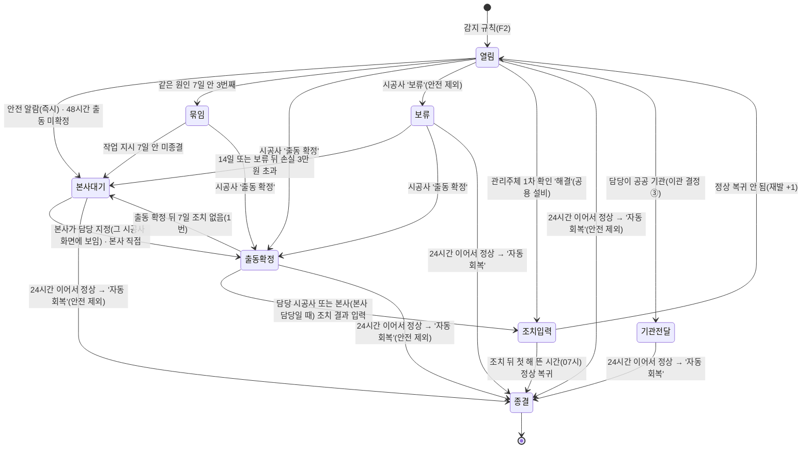
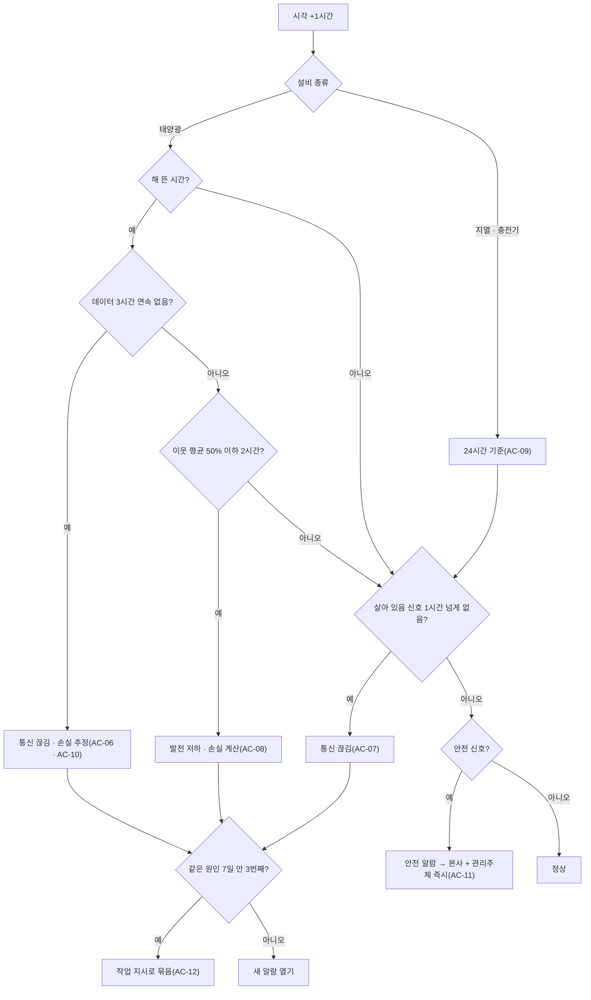
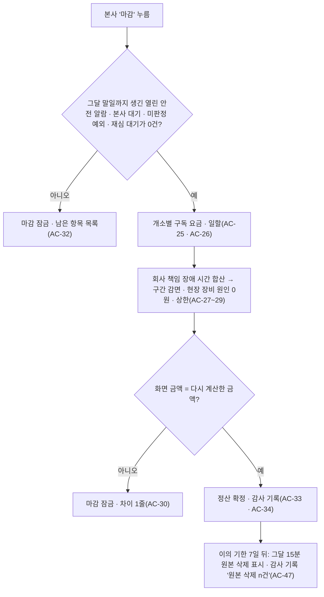
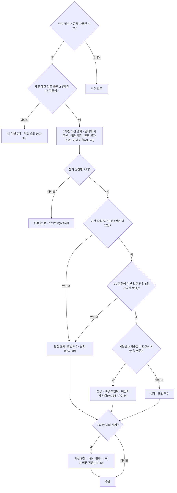

# 흐름 설계

> 상태: 승인 · 구현에 맞춰 고침(2026-11-25, Q18 반영) · 근거: [requirements.md](requirements.md) · [data-model.md](data-model.md)

## F1. 알람 생애주기 (AC-06~18 · AC-69~74 · AC-79)

- 사람이 누른 행동은 같은 시각에 바로 반영한다.
- '확인'은 상태를 바꾸지 않는다(본 표시만). 종결은 조치 결과 + 정상 복귀 둘 다일 때만(AC-17).
- 묶인 동안 **다른 원인** 알람이나 **손실이 더 큰** 알람은 새로 연다(AC-14).
- 본사 대기 항목은 사라지지 않고, 그달 말일까지 생긴 것이면 그달 월 정산 마감을 잠근다(F4).
- 기한 넘긴 작업 지시는 본사로 1번 올라가고, 본사가 담당을 정하면 그 시각부터 새 기한 7일을 준다. 새 기한 전에는 다시 올리지 않는다(AC-69).
- '관리 종료'(이관 결정 ① 소유주 책임 안내 · ② 철거 안내) 설비는 안전이 아닌 알람을 만들지 않는다. 열려 있던 일반 알람은 그 시각에 '관리 종료'로 닫는다(AC-73). 안전 알람은 그대로 본사 대기(AC-11).
- 자동 회복은 감지될 때 이미 재발 세기에 1번 들어간다. 종결할 때 다시 세지 않는다. 작업 지시는 사람이 조치를 넣어야 끝난다.

## F2. 알람 감지 (시연 시각이 1시간 지날 때마다)

- 담당 시공사가 비어 있으면 알람을 열기 전에 본사를 담당으로 넣고 감사 기록(AC-16).
- 손실 금액(태양광만) = 이웃 평균 대비 모자란 kWh × 가상 단가. 통신 끊김은 설비 용량 × 이웃 평균 발전으로 추정하고 '추정' 표시(AC-10).
- 지열 · 충전기는 금액을 매기지 않고 '가동 저하 n시간' · '끊김 n시간'으로 보여 준다(AC-77).
- 목록 순서: 안전 → 금액 있는 알람(손실 큰 순) → 금액 없는 알람(오래된 순)(AC-78). 출동 묶음도 같은 순서.

## F3. 출동 묶음 (AC-19 · AC-20)

1. 시공사 화면을 열면 구역별로 열린 알람을 손실 큰 순으로 모은다.
2. 구역마다 최대 5곳을 한 묶음으로 제안하고 배치도에 경로 점선을 그린다.
3. 시공사가 '출동 확정'을 눌러야 알람 상태가 `출동확정`이 된다(Q3).
4. 안전 알람은 묶음 맨 앞에 둔다.

## F4. 월 정산 마감 (AC-25~35)

- 3초 안에 끝낸다(AC-33). 세대 15분 원본은 이 단계와 미션 판정(F5)에서만 읽는다.

## F5. 미션 → 판정 → 포인트 → 이의 (AC-37~42 · AC-44 · AC-59)

기준선 = 미션이 열리지 않았던 직전 평일 5일(최대 30일 전까지)의 같은 시간 평균(AC-38, Q13). 예산 소진으로 열리지 않은 날은 기준선에 쓴다.
기준선은 15분 원본이 아니라 **기준선용 1시간 합계**에서 읽는다. 1시간 합계는 판정 시각 앞 30일까지만 읽을 수 있다(AC-75). 그래서 지난달 15분 원본을 지운 뒤에도 다음 달 미션을 판정할 수 있다.
판정은 **참여 신청한 세대만** 한다. 신청하지 않은 세대는 판정 0건 · 포인트 0점(AC-76).

- 판정 결과는 처음 판정할 때 `missionLog`에 기록하고 다시 계산하지 않는다. 재심 결과는 기록 위에 덧씌운다.

## F6. 역할 전환과 화면 데이터 (AC-01~05 · AC-46)

1. 버튼으로 역할을 고른다. 저장소의 역할 값은 믿지 않는다(SEC-01).
2. `views.forRole(역할)`이 규칙 · 정산 결과를 받아 노출표(data-model 3절)대로 걸러 낸다.
3. 걸러 낸 결과만 화면에 넘긴다. 화면은 `textContent`로만 그린다(AC-49).

## F7. 저장 · 복구 · 초기화 (AC-52 · AC-53)

1. 시작할 때 `zed:v1:state`를 읽는다. 없거나 버전이 다르거나 형식이 깨졌으면 기본 상태로 되돌리고 안내 1줄.
2. '시연 초기화'는 상태와 감사 기록을 지운 뒤, 새 감사 기록 첫 줄에 '시연 초기화'를 남긴다.

## F8. 의무 기한 · 보고서 · 보증 (AC-21~24)

1. 시공사 화면을 열면 설비마다 의무 3가지(하자보증 만료 · 사후관리 연 1회 보고(3년) · 통합모니터링 연계 유지(5년))의 남은 날을 계산하고 공고문 출처 링크와 "법률 검토가 아닌 확인 목록"을 함께 보여 준다(AC-21).
2. 그 해 제출 기록이 0건이고 보고 기한이 30일 이하로 남으면 '기한 임박'을 붙인다(AC-22).
3. '보고서 초안' → 가상 양식(설비 · 기간 · 알람 · 조치 이력) → 시공사 '제출' → 제출 기록 1건 · 감사 기록(AC-23). 공단 시스템으로 보내지 않는다.
4. 하자보증 기간 안 고장이 종결되면 '보증 청구 대상'을 붙인다(AC-24). 보증 만료 30일 이내 설비는 예외 대기열에도 올린다(AC-31).

## F9. 현장 1차 확인 · 보류 (AC-60~66)

1. 단지 공용 설비에 안전이 아닌 알람이 열리면 관리주체 화면에 설비 종류별 체크리스트 3개(태양광: 인버터 표시등 · 차단기 · 통신 장치 전원 / 지열 · 충전기: 운전 표시등 · 차단기 · 통신 장치 전원)가 뜬다. 안전 알람은 "전문가만 조치"만 보인다.
2. 관리주체가 '해결' → 조치입력(조치 뒤 첫 해 뜬 시간 복귀 확인 뒤 종결, F1과 같음). '안 됨' → 시공사 화면에 "현장 1차 확인: 안 됨" 1줄, 상태는 그대로.
3. 시공사는 하루 손실을 보고, 작은 고장은 '보류(다음 정기 방문)'로 둘 수 있다. 보류 중에는 48시간 올림이 멈춘다.
4. 보류 뒤 14일이 지나거나 쌓인 손실이 30,000원을 넘으면 본사 대기열로 1번 올라간다. 지열 · 충전기는 금액이 없어 14일 조건만 쓴다.

## F10. 본사 임시 관리 기한 (AC-16 · AC-67)

1. 담당이 비면 본사가 맡는다(AC-16).
2. 30일이 지나면 예외 대기열에 '이관 결정 필요'가 올라온다(마감 잠금 대상).
3. 본사가 ① 소유주 책임 안내 ② 철거 안내 ③ 공공 기관 배정 중 하나를 고른다.
   - ① · ②: 설비가 '관리 종료'가 된다. 일반 알람은 만들지 않고, 안전 알람만 본사 대기로 올린다. 청구하지 않는다(AC-73).
   - ③: 담당이 가상 '공공 사후관리 기관'으로 바뀐다. 일반 알람은 '기관 전달'로 두고 본사 대기열에 올리지 않는다. 청구하지 않는다(AC-74).
4. 시공사 계약 종료 예외의 선택지('본사 임시 관리 확인' · '새 시공사 찾기 시작')는 기록만 남긴다. 실제 담당 변경은 30일 뒤 이관 결정에서 한다.

## 끝 조건 점검 (되풀이되는 곳)

| 되풀이 | 끝 조건 | 근거 |
|---|---|---|
| 같은 원인 알람 재발 | 7일 안 3번째에 작업 지시로 묶음. 묶음 7일 미종결이면 본사로 1번 올림. 본사가 담당을 정하면 새 기한 7일, 그 전에는 다시 안 올림 | AC-12 · AC-13 · AC-69 |
| 출동 확정 뒤 방치 | 7일 안 조치 결과가 없으면 본사로 1번. 본사가 다시 지정하면 새로 7일 | AC-70 |
| 저절로 회복된 고장 | 24시간 이어서 정상이면 '자동 회복'으로 종결(안전 제외) | AC-79 |
| 공공 기관 전달 | 본사로 올리지 않음. 24시간 정상이면 자동 회복으로 종결 | AC-74 · AC-79 |
| 출동 미확정 | 48시간 뒤 본사로 1번 올림. 본사 대기는 마감을 잠가 결국 처리됨 | AC-15 · AC-32 |
| 조치 뒤 다시 열림 | 다시 열림도 재발 횟수로 세어 위 묶음 규칙으로 이어짐 | AC-18 |
| 이의 제기 | 미션마다 1번, 재심 1번 뒤 버튼 잠금 | AC-40 |
| 마감 재시도 | 잠금 사유 목록을 보여 줌. 사유가 0건이 되면 마감 가능(사람이 처리) | AC-32 · AC-30 |
| 판정 불가 | 같은 미션을 다시 판정하지 않음. 다음 미션으로 넘어감 | AC-39 |
| 예산 소진 | 새 미션을 열지 않음. 관리주체가 새 예산을 승인해야 다시 엶 | AC-41 · AC-44 |
| 보류 | 14일 또는 보류 뒤 손실 30,000원 초과 시 본사로 1번 | AC-65 |
| 본사 임시 관리 | 30일 뒤 이관 결정 1건, 결정하면 끝(관리 종료 또는 공공 기관) | AC-67 · AC-73 · AC-74 |
| 다음 달 미션 기준선 | 15분 원본 삭제와 무관하게 1시간 합계 30일로 판정, 30일보다 오래된 값은 안 읽음 | AC-75 |
| 저장 값 깨짐 | 기본값으로 1번 되돌림. 되돌린 뒤 다시 깨지면 저장 없이 기본값으로 동작 | AC-52 |
